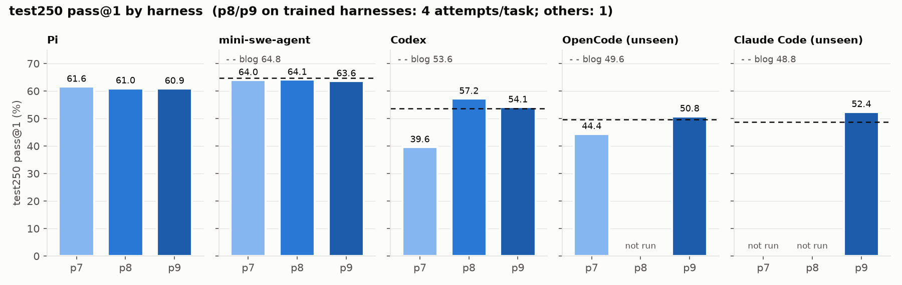
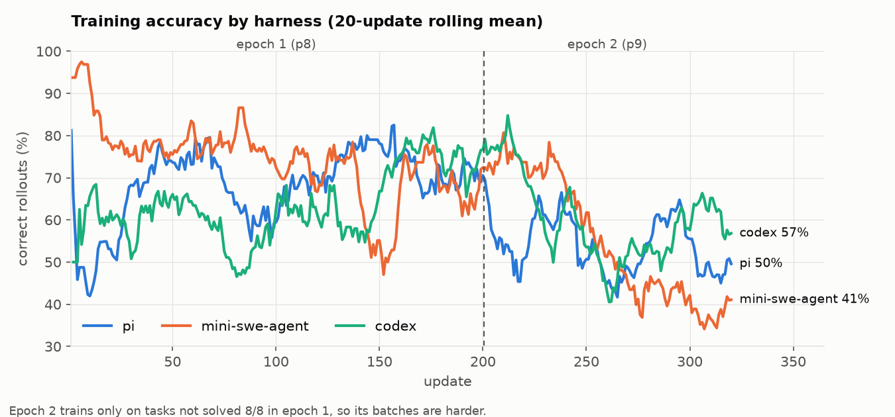
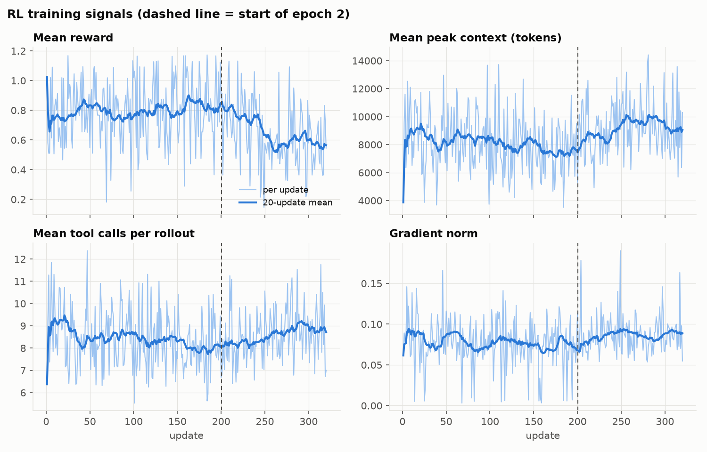

# Data Agent RL: LFM2.5-2.6B trained with GRPO on a single L4

We RL-trained **LiquidAI/LFM2.5-2.6B** (rev `654f9463`) to act as a data-analysis agent on the
FineEnvs / SmolDataEnvs data-agent tasks (Kaggle datasets plus a question; the agent explores the files
with code inside a sandbox and writes one answer). The goal was to match or beat the reference
multi-harness RL result (Adithya's blog) under much tighter hardware: **one NVIDIA L4 (23 GB)**,
FP8 sampling and training, a 24k context window instead of 128k, and no prompt hints.

Full experiment log: [EXPERIMENTS.md](EXPERIMENTS.md). Benchmark and setup flaws: [FINDINGS.md](FINDINGS.md).
Plan history: [PLAN.md](PLAN.md).
LoRA weights (not in this repo): [makireddyvighnesh/lfm2.5-2.6b-data-agent-lora](https://huggingface.co/makireddyvighnesh/lfm2.5-2.6b-data-agent-lora) (private; root = p8 u200, `p9_u120/`).

## Headline results (test250, the blog's test split)

pass@1. r4 = 4 attempts per task (1,000 per cell, about ±1.5 pts); r1 = 1 attempt (about ±3 pts).

| Harness | Trained on it? | p7 u350 (pi-only RL) | **p8 u200 (best)** | p9 u120 (epoch 2) | Blog multi-harness (128k) |
|---|---|---|---|---|---|
| Pi (bash only) | yes | 61.6 (r1) | **61.0** (r4) | 60.9 (r4) | - |
| mini-swe-agent | yes | 64.0 (r1) | **64.1** (r4) | 63.6 (r4) | 64.8 |
| Codex CLI | yes | 39.6 (r1) | **57.2** (r4) | 54.1 (r4) | 53.6 |
| OpenCode | no | 44.4 (r1) | not run | 50.8 (r1) | 49.6 |
| Claude Code | no | (see EXPERIMENTS.md) | not run | 52.4 (r1) | 48.8 |

- A 2.6B model at 24k context matches the blog on mini-swe-agent and **beats it on Codex (+3.6), OpenCode
  (+1.2, p9) and Claude Code (+3.6, p9)**.
- Multi-harness training (p8) fixed the weak harness: Codex +17.6 over p7 (43 tasks gained / 8 lost on r1),
  submit rate 63% -> 88%, peak context 14.8k -> 12.3k, without hurting Pi or mini-swe-agent.
- It also transfers to harnesses never trained on: OpenCode +6.4 over p7.
- Epoch 2 (p9) did not help: flat on Pi and mini-swe-agent, Codex -3.1 ± 2.5. **p8 u200 is the best checkpoint.**

Val118 (our own 118-task holdout from the eval split), Pi, r1: base 39.8 (thinking on), p7 u350 53.4, p8 u200 60.2.



## Training curves

p8 (epoch 1, updates 1-200) and p9 (epoch 2, updates 201-320). Regenerate with `python analysis/plot_readme.py`.



- Codex, the harness the starting checkpoint was weakest on, climbs from about 60% to 75-80% during epoch 1.
- Epoch 2 batches are harder by construction (only tasks not solved 8/8), so its raw accuracy drops; on the same
  tasks epoch 2 still beat epoch 1 by 5-11 points per window, but test250 showed no gain.



- Reward follows accuracy (correct answers earn 1 plus up to 0.2 in efficiency bonuses).
- Peak context falls from about 9k to 7.5k tokens and tool calls from about 9 to 8 during epoch 1, as the
  efficiency bonuses intend; both rise again on the harder epoch-2 tasks.
- Gradient norm stays in a narrow 0.06-0.10 band: no instability or collapse in either epoch.

## Method

- **Algorithm:** GRPO, LoRA r16 / alpha 32 on a frozen FP8 base, 4 tasks x 8 rollouts per update, advantage
  std floor 0.1, truncated importance sampling (cap 2) to correct the FP8 vLLM sampler vs trainer mismatch.
  Each multi-turn rollout trains as one prefix-chained sequence. Thinking (`<think>`) on.
- **One GPU for everything:** vLLM sampler (FP8 weights, FP8 KV, sleep mode) and the trainer share the L4;
  rollouts stream (`--stream-groups 2`) so generation overlaps grading. About 5-6 min per update.
- **Harnesses (p8):** Pi (bash tool only), mini-swe-agent 2.4.6, Codex CLI 0.163.0, rotated per task
  (all 8 rollouts of a task use the same harness), all run through Harbor sandboxes with a capture proxy
  that records exact token ids and caps every model call at 4,096 output tokens.
- **Reward (`tool_ctx`):** wrong = 0; correct = 1 + 0.1 x 15/(15 + tool calls) + 0.1 if the rollout's own
  context (peak minus first prompt) stayed within 15k. Bonuses only for correct answers.
- **Data:** 798 training tasks (the 1,000-task pool minus 202 never solved); learning rate 3e-5 cosine,
  10 warmup steps, 200 updates = one pass over the tasks. Started from the p7 u350 adapter.

## Run history

| Run | What changed | Result |
|---|---|---|
| base | LFM2.5-2.6B, thinking on | val118 39.8 |
| p3-p5 | tool-call bonus, peak-context bonus, tool-output cap | val118 up to 48.3 (r4) |
| p6 | LoRA r16, 1000 tasks, time/token-shaped reward, 10-min cap | test250 56.0 |
| p7 | + thinking, Pi bash-only, turn cap 25, drop never-solved tasks | test250 61.6 (Pi) |
| sd_p7 | SFT on p7's own correct rollouts | test250 58.0 (not better) |
| **p8** | **+ Pi / mini-swe-agent / Codex, 24k, `tool_ctx` reward** | **best: see table** |
| p9 | epoch 2 on the 477 tasks not solved 8/8 | no gain, Codex -3.1 |

## Findings

**What worked**
- Thinking on: +8.9 points at base on val118.
- Pi with only a bash tool: full-file `read` dropped from 90% to 0% of rollouts, which removed most context blowups.
- Rewarding efficiency only on correct answers (tool-call and context bonuses): shorter, faster solutions without
  trading off accuracy.
- Dropping never-solved tasks: removes all-zero groups (no gradient) and many tasks with bad gold answers.
- Training on several harnesses: big gains on the weakest harness and transfer to unseen harnesses.
- Pre-installing every harness in the sandbox image (per-rollout installs time out under concurrency).

**What did not work**
- More updates or epochs of the same recipe: val118 plateaus after about 200 updates (p5, p6, p7); epoch 2 (p9)
  gave nothing and slightly hurt Codex.
- Self-distillation on the model's own correct rollouts (sd_p7): close to p7, not better.
- A tool-output cap without a context cost: the model kept reading whole files.
- Deciding from r1 val118: same-model reruns flip about 18% of tasks, so 1-attempt differences under about
  5 points are noise. All final claims use r4 on test250.

**Benchmark caveats (see FINDINGS.md)**
- The pinned grader has false positives and false negatives (about 3.8% error vs blind judges); some tasks are
  unanswerable or under-specified. These affect the blog's numbers and ours equally.
- "Held-out" test tasks are new questions, but some reuse the same data files as training (no task, notebook or
  question overlap).
- Our comparison with the blog differs in context (24k vs 128k) and thinking (on vs off).

## Repository layout

| Path | Contents |
|---|---|
| `run_train_mh.sh`, `run_train_mh_e2.sh` | p8 and p9 training launchers (wrap `train_grpo.sh`) |
| `run_train_*.sh`, `run_ablations.sh` | earlier runs (p3-p7) and ablations |
| `run_test250_p7.sh`, `run_mh_baseline.sh`, `run_p9_confirm.sh`, `eval_checkpoint.sh` | evaluation |
| `restart_vllm.sh`, `serve_harbor.py`, `runtime_vllm_worker.py`, `root_proxy.py` | vLLM and Harbor serving with runtime patches (upstream OpenEnv/Harbor/TRL left unmodified) |
| `grader_v3.py`, `prepare_eval.py`, `prefetch_data.py` | fixed grader and task-data preparation |
| `manifests/` | task lists: `train798`, `train_e2`, `val118`, ... |
| `sandbox_image/` | sandbox Dockerfiles (`Dockerfile.mh` = all harnesses preinstalled) |
| `analysis/` | analysis scripts (`merge_r4.py`, `category_overlap.py`, `plot_readme.py`, failure reviews) |
| `docs/plots/` | README figures (training curves, test250 results) |
| `smoldataenvs/` | snapshot of our SmolDataEnvs training code: `pirl/` (GRPO trainer, rewards, evaluator), tests |
| `EXPERIMENTS.md`, `FINDINGS.md`, `PLAN.md` | experiment log, flaws found, plan history |

Not in git (see `.gitignore`): `runs/` (rollouts, logs, checkpoints; 117 GB), `results/` (eval summary JSONs),
`prepared*/` (task data), model weights.

## Reproducing

The scripts expect this layout on the training machine (paths are relative to this folder):

```
MiMo_rl/
  Data Agent/      <- this repo
  SmolDataEnvs/    <- SmolDataEnvs checkout with smoldataenvs/ copied over it, .venv, OpenEnv, trl
```

```bash
# vLLM at 24k with thinking on, FP8 KV, prefix chaining
PIRL_THINKING=1 MAX_LEN=24576 CHAIN=1 SEQS=64 KV=fp8 LORA_RANK=64 ./restart_vllm.sh
# sandbox image with all harnesses
docker build -f sandbox_image/Dockerfile.mh -t pirl/sandbox:pi-mh2 sandbox_image
docker tag pirl/sandbox:pi-mh2 savatar101/env-data-agent-train:base
# train p8 (in tmux), then evaluate
./run_train_mh.sh 200
HARNESS=codex RPT=4 ./run_test250_p7.sh my_label p8u200 runs/p8_mh/checkpoint-200/adapter
```
