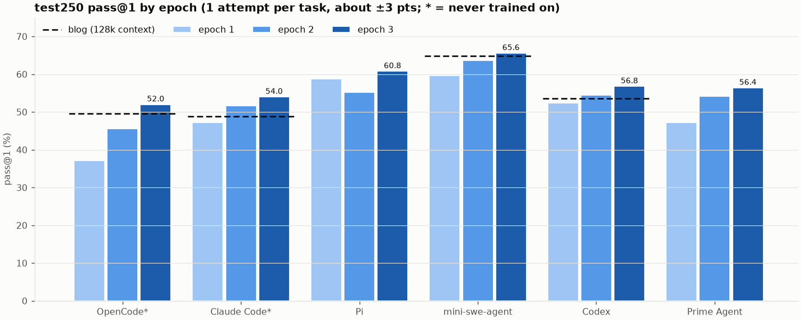
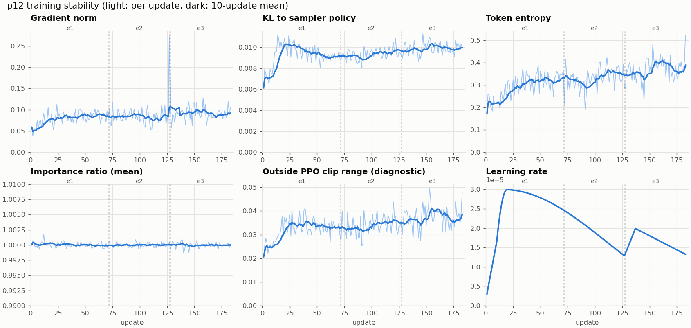
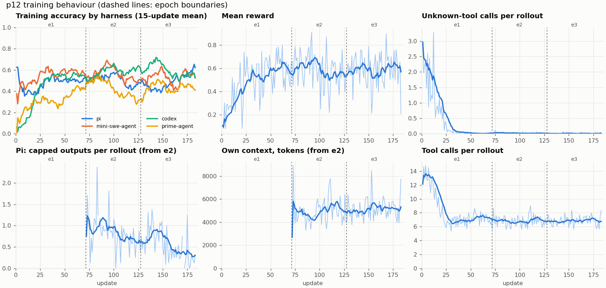

# Data Agent RL: LFM2.5-2.6B trained with GRPO on one L4

RL training of **LiquidAI/LFM2.5-2.6B** (rev `654f9463`) as a data-analysis agent on the FineEnvs / SmolDataEnvs
data-agent tasks: each task gives Kaggle data files and a question; the agent explores the files with code in a
sandbox and writes one answer, which a grader checks.

Constraints: **one NVIDIA L4 (23 GB)** for both sampling and training, FP8 base weights, 24k context
(the reference [multi-harness RL blog](https://huggingface.co/spaces/FineEnvs/multi-harness-rl) uses 128k), thinking off, no prompt hints.

## Results

test250 (the blog's test split), pass@1, 1 attempt per task (about ±3 points). Best run: **p12 epoch 3**.

| Harness | Trained on it? | p12 e1 | p12 e2 | **p12 e3** | Blog multi-harness (128k) |
|---|---|---|---|---|---|
| OpenCode | no (held out) | 37.2 | 45.6 | **52.0** | 49.6 |
| Claude Code | no (held out) | 47.2 | 51.6 | **54.0** | 48.8 |
| Pi | yes | 58.8 | 55.2 | **60.8** | - |
| mini-swe-agent | yes | 59.6 | 63.6 | **65.6** | 64.8 |
| Codex CLI | yes | 52.4 | 54.4 | **56.8** | 53.6 |
| Prime Agent | yes | 47.2 | 54.2 | **56.4** | - |

- Epoch 3 is the best checkpoint on all six harnesses.
- It is above the blog on all four harnesses the blog reports, including the two it never trained on. The margins
  (+0.8 to +5.2) are within 1-attempt noise; a 4-attempt run is needed to confirm them.
- Pi used only `bash` in e1 and `bash` + `read` from e2, so Pi e1 is not directly comparable.



## Training

**Training was stable for all 183 updates (3 epochs).** No collapse, no divergence, no rollbacks.



| Signal | Range over 183 updates | Reading |
|---|---|---|
| Gradient norm | 0.04-0.11 (median 0.085); one spike to 0.27 at u127 | flat band, the spike did not repeat |
| KL to sampler policy | 0.006-0.011 | flat; comes from the one-update lag of async generation |
| Importance ratio | 0.999-1.002 | the FP8 sampler and the trainer agree; TIS caps only 0.2% of tokens |
| Tokens outside the PPO clip range | 2-5% | diagnostic only (the TIS loss does not clip); rises with the higher e3 lr, still small |
| Token entropy | 0.22 (first 10 updates) -> 0.39 (last 10) | rising, not collapsing: the policy keeps exploring |
| Learning rate | cosine from 3e-5; e3 re-spans the schedule to 300 updates | the jump at u128 is that re-span, not a restart |



- Training accuracy rises in e1 (Prime Agent from about 0.1 to 0.45, the others to 0.5-0.6), then stays level:
  from e2 on, tasks solved 8/8 earlier are skipped, so later batches are harder by construction. Test scores
  (above) keep rising.
- Invented-tool calls fall from about 3 per rollout to about 0.02 within 35 updates and stay there.
- Tool calls per rollout fall from about 13 to 7 in e1 and stay there.
- Pi's capped tool outputs (whole files dumped into the context) fall from about 1.1 to 0.3 per rollout over e2-e3.

Plots: `python3 analysis/plot_p12.py` (reads `runs/p12_mh4_r32/metrics.jsonl` and `results/`).

## Method

| Part | Setting |
|---|---|
| Algorithm | GRPO, fresh LoRA r32 / alpha 64 on the frozen FP8 base; 8 tasks x 8 rollouts per update; advantage std floor 0.1 |
| Off-policy fix | truncated importance sampling: each token weighted by min(π_train / π_sampler, 2), for stale async samples and the FP8 sampler vs trainer mismatch; no PPO clipping (one gradient step per batch) |
| Sampling | DAPO dynamic sampling (drop groups with no reward spread), async generation (14 groups in flight) |
| Task selection | 1,000 training tasks; solved tasks skipped (25% revisited in e3), 50% of all-wrong revisits skipped, extra probes for hard tasks |
| Harnesses | Pi, mini-swe-agent, Codex, Prime Agent (rotated per task); OpenCode and Claude Code held out for testing |
| Sandbox | Harbor sandboxes; a capture proxy records exact token ids, caps each model call at 4,096 tokens and each tool output at 4,000 chars |
| Schedule | lr 3e-5 cosine (warmup 10, floor 3e-6); 1 epoch = 1,000 task positions; e1 u1-71, e2 u72-127, e3 u128-183 |
| Hardware | one L4: vLLM (FP8 weights, FP8 KV cache, sleep mode) and the trainer share the GPU; about 8.5 min per update |

### Reward (epoch 3: `tool_ctx_read2`)

```
wrong or no answer:  0                                                        - unknown-tool penalty
correct answer:      1 + tool bonus + own-context bonus - capped-output penalty - unknown-tool penalty
```

| Term | Value | Purpose |
|---|---|---|
| Tool bonus | 0.1 x 15 / (15 + tool calls) | fewer, better tool calls |
| Own-context bonus | 0.1 at <= 4k own tokens, falling to 0 at 12k (own = peak context - first prompt) | keep the context small |
| Capped-output penalty | 0.05 per tool output cut by the 4,000-char cap, max 0.2 | read slices, not whole files |
| Unknown-tool penalty | 0.1 per call to a tool the harness does not offer, max 0.3 | use the tools the harness gives |

A correct answer always scores at least 0.5 and a wrong one at most 0, so correctness dominates. The efficiency terms
only rank correct answers against each other, and penalties never make a wrong answer look better.

| Epoch | Reward | Change |
|---|---|---|
| e1 | `tool_ctx_err` | tool bonus, flat context bonus, unknown-tool penalty |
| e2 | `tool_ctx_read` | + capped-output penalty, graded context bonus, Pi gets `read` |
| e3 | `tool_ctx_read2` | capped-output penalty on correct answers only; keep all-correct groups with reward spread >= 0.03; lr schedule over 300 updates |

## Findings

**What worked**
- Training on several harnesses transfers to harnesses never trained on (OpenCode +14.8, Claude Code +6.8 from e1 to e3).
- Penalising unknown tool calls: invented-tool calls in training fell from about 3 to about 0.02 per rollout; on
  Claude Code they now cost no points.
- Capped-output penalty on correct answers only: Pi rollouts with a capped output fell from 60% to 31% during e3
  while Pi accuracy rose (test250 55.2 to 60.8) and tool calls and submit rate held.
- Rewarding efficiency only on correct answers: shorter, cheaper solutions without trading off accuracy.
- Pre-installing every harness in the sandbox image (per-rollout installs time out under concurrency).

**What did not work (earlier runs, see EXPERIMENTS.md)**
- Epoch 2 of the same recipe without changes (p9): no gain.
- Self-distillation on the model's own correct rollouts: not better than RL.
- A tool-output cap without a cost: the model kept reading whole files.
- Removing a tool to stop its misuse (bash-only Pi): stops full-file reads on that harness only; the model does
  not learn to read selectively.

**Remaining losses on test250 (e3)**
- Claude Code: 43 of 250 rollouts run out of context (about 11 points). The fixed prompt takes about 10.8k of the
  24k, and the model writes long visible reasoning messages (some over 8k chars) even with thinking off.
- OpenCode: 57 rollouts pass a bash timeout in seconds where OpenCode expects milliseconds, so the command is killed
  (about 7 points; was 186 rollouts in e1).
- Pi: 18 rollouts end without writing an answer (about 5 points).

**Caveats**
- The pinned grader has about 3.8% error vs blind judges, and some tasks are under-specified. This affects the blog's
  numbers and ours equally.
- Test tasks are new questions, but some reuse data files seen in training.
- 1-attempt differences under about 5 points are within noise (same-model reruns flip about 18% of tasks).

## Run history

| Run | Change | Result (test250) |
|---|---|---|
| p6 | LoRA r16, 1,000 tasks, time/token-shaped reward | Pi 56.0 |
| p7 | thinking on, Pi bash-only, drop never-solved tasks | Pi 61.6 |
| p8 | + mini-swe-agent and Codex, `tool_ctx` reward | Pi 61.0, mini 64.1, Codex 57.2 (4 attempts) |
| p9 | epoch 2 of p8 | no gain; OpenCode 50.8, Claude Code 52.4 |
| p10-p11 | + Prime Agent, unknown-tool penalty | stopped early; fixes carried into p12 |
| **p12** | **fresh start, thinking off, all fixes, 3 epochs** | **best on held-out harnesses; see Results** |

## Repository layout

| Path | Contents |
|---|---|
| `run_train_p12.sh` | full pipeline: Harbor + vLLM startup, one epoch of training (`EPOCH_STOP=1000/2000/3000`), test250 on 6 harnesses |
| `train_grpo.sh` | trainer launcher (wraps `smoldataenvs/pirl/grpo.py`) |
| `run_test250_p7.sh` | test250 evaluation of one adapter on one harness |
| `restart_vllm.sh`, `runtime_vllm_worker.py` | FP8 vLLM server with runtime patches |
| `serve_harbor.py`, `prime_agent_harness.py` | Harbor sandbox server (tool-output cap, Pi tool allowlist, Prime Agent) |
| `grader_v3.py`, `prepare_eval.py`, `prefetch_data.py` | fixed grader and task-data preparation |
| `manifests/` | task lists: `train1000`, `val118` |
| `sandbox_image/Dockerfile.mh` | sandbox image with all harnesses preinstalled |
| `analysis/failure_buckets.py`, `analysis/tool_audit.py` | test250 failure modes; OpenCode timeout audit |
| `smoldataenvs/` | training code: `pirl/` (GRPO trainer, rewards, evaluator, vLLM serving) and tests |
| `EXPERIMENTS.md` | full experiment log |

Not in git: `runs/` (rollouts, logs, checkpoints), `results/` (eval JSONs), `prepared*/` (task data), model weights.
Earlier LoRA weights (p8, p9; private): [makireddyvighnesh/lfm2.5-2.6b-data-agent-lora](https://huggingface.co/makireddyvighnesh/lfm2.5-2.6b-data-agent-lora).

## Reproducing

Expected layout on the training machine:

```
MiMo_rl/
  Data Agent/      <- this repo
  SmolDataEnvs/    <- SmolDataEnvs checkout with smoldataenvs/ copied over it, .venv, OpenEnv, trl
```

```bash
# sandbox image with all harnesses
docker build -f sandbox_image/Dockerfile.mh -t pirl/sandbox:pi-mh2 sandbox_image
docker tag pirl/sandbox:pi-mh2 savatar101/env-data-agent-train:base
# one epoch each (run in tmux); each starts Harbor and vLLM, trains, then runs test250 on 6 harnesses
EPOCH_STOP=1000 ./run_train_p12.sh
EPOCH_STOP=2000 ./run_train_p12.sh
EPOCH_STOP=3000 ./run_train_p12.sh
# stop: touch runs/p12_mh4_r32/STOP; resume: re-run the same command
```

## Acknowledgements

- **Adithya's [multi-harness RL blog](https://huggingface.co/spaces/FineEnvs/multi-harness-rl)** (FineEnvs) is the reference this work builds on and compares against:
  the idea of training one model across several agent harnesses, the test250 split, the blog scores in the tables
  above, and the tool-efficiency reward term (0.1 x 15 / (15 + tool calls)).
- **Open-source data and docs:** the FineEnvs / SmolDataEnvs data-agent tasks and grader, their documentation, and
  the open-source harnesses (Pi, mini-swe-agent, Codex CLI, Prime Agent, OpenCode, Claude Code) and Harbor sandboxes.
- **Our own work:** the single-L4 FP8 training setup, the training runs and experiments (p3-p12), the reward
  changes (unknown-tool penalty, capped-output penalty, graded context bonus), the task-selection rules, the
  grader fixes, and all analysis in this repo and EXPERIMENTS.md.
